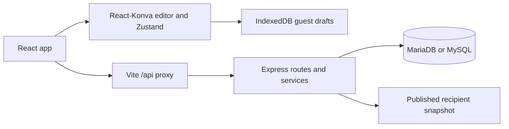

# FeelCraft

FeelCraft is a full-stack digital letter studio. Create a design from an editable template or a blank canvas, then publish an animated letter that a recipient can open without an account.

## Features

- **Visual editor** with editable typography, photo uploads, shapes, canvas backgrounds, layers, drag and resize controls, undo and redo, and autosave. Designs support English and Sinhala text.
- **Template gallery** with five moods, search, filters, and animated previews.
- **Draft management** with browser-local guest drafts, account drafts saved to the database, and a flow to copy a guest draft into an account.
- **Accounts** with registration, sign-in, profile settings, bcrypt password hashing, JWT access tokens, and rotating refresh cookies.
- **Publishing** with immutable snapshots, named or anonymous signatures, optional passwords and expiration, QR codes, and WhatsApp or native sharing.
- **Recipient experience** with a standalone animated reveal, reduced-motion support, optional audio, and abuse reporting. Creators can view aggregate opens and revoke or unpublish their links.

## Stack and architecture

| Layer | Tools |
| --- | --- |
| Frontend | React 19, Vite, React Router, Tailwind CSS, React-Konva, Zustand, Framer Motion |
| API | Node.js, Express, mysql2, Helmet, bcrypt, JSON Web Tokens |
| Persistence | MariaDB or MySQL for accounts and publications, IndexedDB for guest drafts |
| Verification | ESLint, Vitest, React Testing Library, Supertest, Playwright |



```text
frontend/   Public pages, editor, dashboards, recipient views and browser tests
backend/    Express routes, authentication, business logic, SQL repositories and tests
database/  Versioned schema migrations and synthetic starter templates
docs/      API contracts, architecture, design system and verification notes
```

The frontend and API can start independently. Editing a draft leaves its published snapshots intact. Recipient routes render a sanitized snapshot from an unlisted URL.

## Local setup

Use Node.js 22.12+ on the 22.x line or Node.js 24 LTS, npm, and MariaDB 10.4+ or MySQL 8+. Database-backed flows have been verified with XAMPP MariaDB 10.4.32.

From the repository root:

```sh
npm ci
npm run install:apps
```

On Windows, use `npm.cmd` if PowerShell blocks the npm script wrapper. Stop the dev servers before reinstalling dependencies so Windows can release native binaries.

### Database

1. Start your MariaDB or MySQL server. For XAMPP, start its **MySQL** module.
2. Create the development database through your database client:

   ```sql
   CREATE DATABASE IF NOT EXISTS feelcraft_db
     CHARACTER SET utf8mb4 COLLATE utf8mb4_unicode_ci;
   ```

3. Use a dedicated development database account with schema and data permissions for the migrations. Configure it in `backend/.env`.
4. Apply the versioned migrations from the project root:

   ```sh
   npm run migrate --prefix backend
   ```

The runner tracks applied migrations and seeds five synthetic templates. The SQL files contain schema definitions and starter catalog content.

### Environment variables

Copy each application's `.env.example` to `.env` in the same directory. In PowerShell:

```powershell
Copy-Item frontend/.env.example frontend/.env
Copy-Item backend/.env.example backend/.env
```

| File | Variables | Local configuration |
| --- | --- | --- |
| `backend/.env` | `DB_HOST`, `DB_PORT`, `DB_NAME` | Defaults are `localhost`, `3306`, and `feelcraft_db` |
| `backend/.env` | `DB_USER`, `DB_PASSWORD`, `DB_TLS` | Fill in your database account and enable TLS when the server is configured for it |
| `backend/.env` | `JWT_ACCESS_SECRET` | Set a unique random secret of at least 32 bytes |
| `backend/.env` | `HOST`, `PORT`, `NODE_ENV` | Defaults are `localhost`, `5000`, and `development` |
| `backend/.env` | `CLIENT_URL`, `PUBLIC_APP_URL` | Use the local frontend origin for `CLIENT_URL`. Leave `PUBLIC_APP_URL` blank for local links |
| `backend/.env` | `DB_DISABLED` | Set `true` to run with browser-local drafts |
| `frontend/.env` | `VITE_API_BASE_URL`, `VITE_DEV_PORT`, `API_PROXY_TARGET` | Defaults are `/api`, `5173`, and `http://localhost:5000` |

Generate a signing secret locally with `node -e "console.log(require('node:crypto').randomBytes(32).toString('hex'))"` and put it in the ignored backend environment file. Keep credentials out of `VITE_` variables because those values can be bundled into client code.

### Run

Start both apps from the root:

```sh
npm run dev
```

Open [FeelCraft](http://localhost:5173). The API health endpoint is available [through the frontend proxy](http://localhost:5173/api/health).

To run them separately, execute the following commands in separate terminals from the root:

```sh
npm run dev --prefix frontend
npm run dev --prefix backend
```

If an API port is occupied, set `PORT` and update `API_PROXY_TARGET` to match. If you change the frontend port, update `CLIENT_URL` as well. Use the same frontend origin to reopen browser-local drafts.

## Checks

```sh
npm run lint
npm run build
npm test
npm exec --prefix frontend -- playwright install chromium
npm run test:e2e
```

The production bundle is written to `frontend/dist`. Set `FEELCRAFT_TEST_MYSQL=1` to include live database integration tests. Use a development database because those tests create and remove temporary test accounts and drafts. For live browser integration, start both apps, set `PLAYWRIGHT_PORT` to the frontend port, and run the auth and publication suites separately within the API rate limit.

```sh
npm run test:e2e --prefix frontend -- auth.spec.js --workers=1
npm run test:e2e --prefix frontend -- publications.spec.js --workers=1
```

## Sharing and deployment

Localhost links open on the machine serving FeelCraft. To test from another device, serve the built frontend over HTTPS, retain the `/api` proxy and SPA history fallback, and set `PUBLIC_APP_URL` to that origin. Copy a fresh share link when the public origin changes. Keep MariaDB and environment files private. Recipient API responses use `no-store` caching and generic metadata.

<details>
<summary>Optional Cloudflare Quick Tunnel for temporary testing</summary>

Use three terminals at the repository root. Stop any instances already using the selected ports before starting. Keep the database running. Install `cloudflared` using Cloudflare's official installation guide or use the ignored workspace-local binary if present.

Frontend preview (PowerShell):

```powershell
$env:VITE_API_BASE_URL = '/api'
npm.cmd run build
$env:FEELCRAFT_TUNNEL_PREVIEW = '1'
$env:VITE_DEV_PORT = '5213'
$env:API_PROXY_TARGET = 'http://127.0.0.1:5033'
npm.cmd run preview --prefix frontend
```

Tunnel (PowerShell):

```powershell
cloudflared tunnel --url http://127.0.0.1:5213 --http-host-header localhost:5213 --protocol http2 --no-autoupdate
```

For a workspace install, replace `cloudflared` with `& '.\.local-tools\cloudflared.exe'`. Copy the HTTPS origin it prints.

API (PowerShell):

```powershell
$env:DB_DISABLED = 'false'
$env:HOST = '127.0.0.1'
$env:PORT = '5033'
$env:CLIENT_URL = 'http://localhost:5213'
$env:PUBLIC_APP_URL = Read-Host 'Paste the Quick Tunnel HTTPS URL'
npm.cmd start --prefix backend
```

Copy a new link from Published Messages to test on another device. End external access with Ctrl+C in the tunnel terminal. A restarted Quick Tunnel gets a new hostname.

</details>

Additional documentation includes the [API reference](docs/API_DOCUMENTATION.md), [database design](docs/DATABASE_DESIGN.md), [architecture notes](docs/ARCHITECTURE.md), and [development progress](docs/PROGRESS.md).
