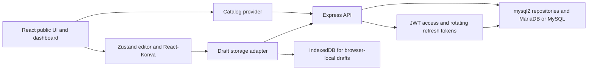

# Architecture

The two apps have independent run commands and environment files. Vite proxies same-origin requests to Express. The HTTP flow is middleware, controller, service or repository, then the database. Parameterized repository commands scope every design operation to its owner. Migration commands run separately and acquire a named database lock.

A draft is a versioned document plus a title and revision. The editor uses Zustand snapshots for undo and redo, renders selectable layers with Konva and debounces writes. Revision checks protect drafts from stale saves in another tab. The preview shares the canvas renderer and uses the existing Framer Motion recipient reveal.

The catalog loads database-backed records whenever the API is available. A clearly labeled bundled collection supports offline bootstrapping. Guest drafts remain on the current browser and origin. Signed-in account drafts use the configured database through the API.

For production, serve the SPA with history fallback, HTTPS, and /api forwarded to Express. Configure the deployment's trusted proxy before depending on per-IP limits.
