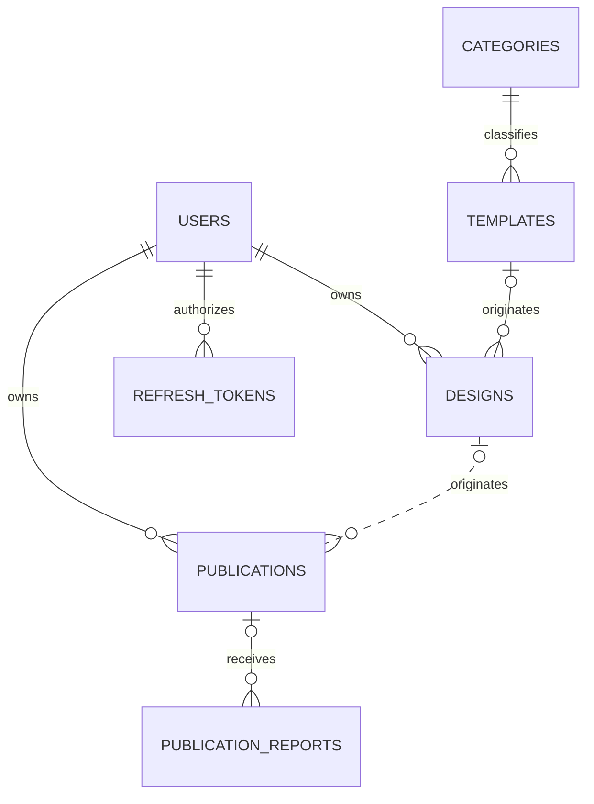

# Database design

Target XAMPP MariaDB 10.4+ and MySQL 8+ with database `feelcraft_db`. The migration runner records applied migrations in `schema_migrations`.

| Table | Purpose |
| --- | --- |
| users | Unique email, bcrypt hash, name, and user or admin role |
| refresh_tokens | Unique opaque-token digests, owner and expiration |
| categories | Slug, sort order and category metadata |
| templates | Slug, category foreign key, publication status, version, display metadata and editable JSON |
| designs | Owner, nullable template origin, title, editable JSON, optimistic revision and timestamps |
| publications | Owner, historical design ID, unique random token, immutable JSON snapshot, access settings and aggregate opens |
| publication_reports | Reason, bounded details and optional reference to a publication |

Users and owned drafts use UUIDs. The schema uses `utf8mb4` for Sinhala and English. Deleting a user cascades to refresh tokens and drafts. Removing a template preserves the derived drafts. Repository operations use parameterized SQL. Refresh-token replacement is atomic, and design updates increment the revision only if the previous one matches.

The shared schema uses `utf8mb4_unicode_ci` for user and design text. MariaDB returns its JSON alias as text, while mysql2 can return native MySQL JSON as an object. The repositories already normalize both forms. Use logical SQL export and import when moving data between engines.

Migration `003_publications.sql` introduces publications and reports. Migration `004_publication_source_reference.sql` removes the source-design foreign key to avoid overlapping delete cascades on MariaDB. Publishing checks the source and its owner in the insertion query. Deleting a draft preserves previously published copies and removes their new-version shortcut. Deleting a publication detaches its reports.

Privacy updates increment an access version and preserve the saved design and sender identity. Publishing new content or identity creates a new token. The older link stays available until it is closed or expires. Template version history and separate remote media storage remain later work.
